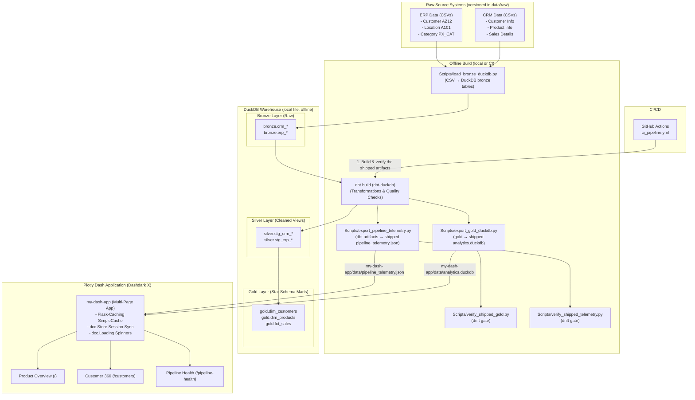
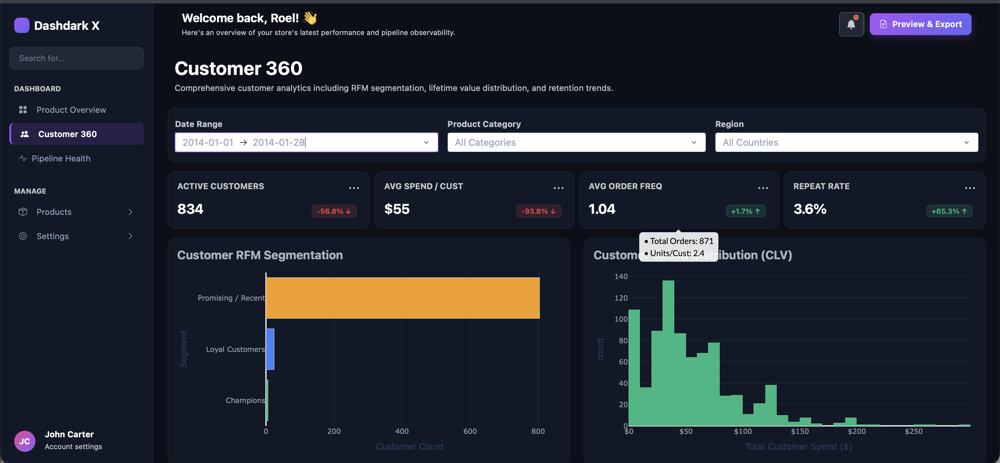
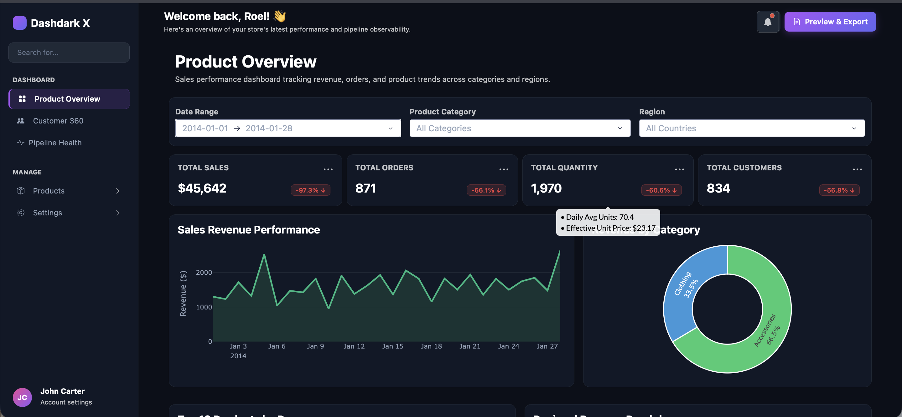
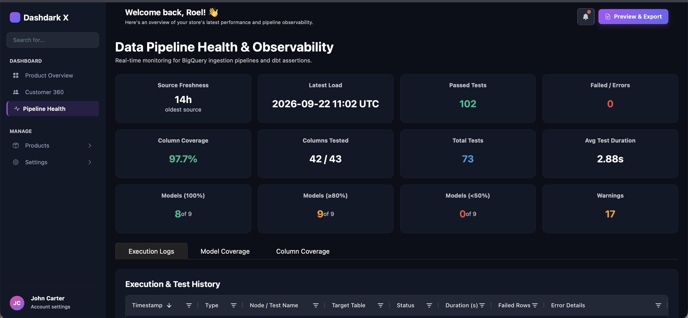
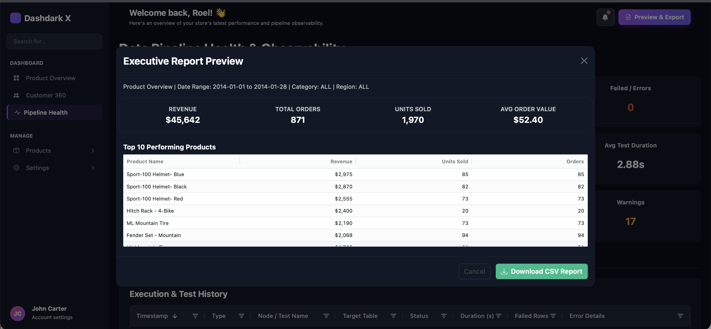

# 🚀 Enterprise Data Warehouse, Pipeline Observability & Analytics Platform

> ✅ **Live on Vercel.** The BigQuery project and the Supabase project behind the original Cloud Run deployment were deleted. The dbt transformation layer was rebuilt on **DuckDB**, and the app now **reads a shipped gold database plus a shipped telemetry artifact at runtime — there is no warehouse in the request path**. Authentication runs on a new Supabase project. See [docs/vercel-migration-plan.md](docs/vercel-migration-plan.md) for the full runbook.

> 🌐 **Live Interactive App:** [https://dbt-bigquery-warehouse.vercel.app](https://dbt-bigquery-warehouse.vercel.app)

Sign in with your own Supabase account, or use the **Continue with Google** / **Continue with GitHub** buttons on the login page.

[](https://www.python.org/)
[](https://www.getdbt.com/)
[](https://duckdb.org/)
[](https://dash.plotly.com/)
[](https://www.docker.com/)
[](https://github.com/features/actions)
[](https://github.com/astral-sh/uv)


An end-to-end, production-grade enterprise data engineering and business intelligence platform. The system ingests raw multi-source enterprise data (CRM & ERP), transforms it through a Medallion Architecture (Bronze &rarr; Silver &rarr; Gold) with **dbt** on **DuckDB**, captures and logs data quality test telemetry, and visualizes metrics via an interactive, containerized **Plotly Dash** application.

---

## 📌 Table of Contents

- [Executive Summary](#-executive-summary)
- [System Architecture](#-system-architecture)
- [Major Implementations](#-major-implementations)
  - [1. Multi-Source Ingestion & ETL Automation](#1-multi-source-ingestion--etl-automation)
  - [2. Medallion Data Modeling & Quality Assertion Layer (dbt)](#2-medallion-data-modeling--quality-assertion-layer-dbt)
  - [3. Pipeline Observability, Test Coverage & Telemetry Logging](#3-pipeline-observability-test-coverage--telemetry-logging)
  - [4. Interactive Multi-Page Dash Application ("Dashdark X")](#4-interactive-multi-page-dash-application-dashdark-x)
  - [5. CI/CD Pipeline & Google Cloud Run Deployment](#5-cicd-pipeline--google-cloud-run-deployment)
  - [6. Supabase Authentication & Access Control](#6-supabase-authentication--access-control)
- [Screenshots & Dashboards](#-screenshots--dashboards)
- [Technology Stack](#-technology-stack)
- [Project Directory Structure](#-project-directory-structure)
- [Getting Started & Local Setup](#-getting-started--local-setup)
  - [Prerequisites](#prerequisites)
  - [Environment Configuration](#environment-configuration)
  - [Running the Ingestion & dbt Pipeline](#running-the-ingestion--dbt-pipeline)
  - [Supabase & OAuth Configuration](#supabase--oauth-configuration)
  - [Authentication Troubleshooting](#authentication-troubleshooting)
  - [Running the Dash Web App Locally](#running-the-dash-web-app-locally)
  - [Running with Docker](#running-with-docker)
- [Data Models & Schema Reference](#-data-models--schema-reference)
- [Performance & Best Practices](#-performance--best-practices)

---

## 📖 Executive Summary

Modern enterprise analytics demands not only timely reporting, but also transparent data governance and pipeline observability. This repository addresses the entire lifecycle:

1. **Ingests** disparate ERP (customer demographics, geographic locations, product categorization) and CRM (customer profiles, product catalogs, line-item sales orders) datasets.
2. **Transforms** raw records into structured star-schema dimensional models (`dim_customers`, `dim_products`, `fct_sales`) using **dbt Core** and custom macros on **DuckDB**.
3. **Validates** every stage with automated assertions (uniqueness, referential integrity, range constraints, whitespace validation).
4. **Captures Telemetry** from dbt artifacts (`manifest.json` and `run_results.json`) to track run durations, failures, warnings, and column-level test coverage over time.
5. **Presents Business & Data Health Insights** through an interactive, multi-page **Plotly Dash** interface equipped with server-side caching (`Flask-Caching`), client-side session store (`dcc.Store`), asynchronous loading spinners, modal drill-downs, and executive CSV export capabilities.
6. **Secures Dashboard Access** with Supabase email/password authentication, Google/GitHub OAuth support, verified-email access, and server-side protection of pages, data callbacks, and exports.
7. **Continuous Delivery** automatically compiles and tests dbt models on pull requests and verifies that the artifacts the app ships still match the build.

---

## 🏗️ System Architecture



---

## ⚡ Major Implementations

### 1. Multi-Source Ingestion & ETL Automation

- **DuckDB Bronze Loading (`Scripts/load_bronze_duckdb.py`)**:
  - Loads the versioned source CSVs from `data/raw/` into DuckDB `bronze` tables.
  - The column types mirror the original SQL Server bronze DDL (`ddl_create_bronze_*.sql`), so the dbt models read the same values they read in the warehouse.
  - Measures the source row count and the loaded row count independently, and writes a load manifest — the replacement for the retired `audit_metadata.table_ingestion_logs` table.
- **Retired with the warehouse**: `Scripts/ingest_bronze.py` (SQL Server landing), `Scripts/ingest_bigquery.py` (SQL Server → BigQuery) and `Scripts/ingest_dbt_artifacts.py` (BigQuery telemetry streaming) are kept for reference only.
- **Unified Orchestration Pipeline (`run_pipeline.sh`)**:
  - Executes the complete data engineering lifecycle in a single command:
    1. CSV → DuckDB Bronze
    2. `dbt build` (models + tests, DuckDB target)
    3. Gold export and telemetry export.

### 2. Medallion Data Modeling & Quality Assertion Layer (dbt)

- **Medallion Architecture Structure**:
  - **Silver Layer (`analytics_layer/models/staging/`)**: Cleaned and typed views. Handles string normalization, surrogate key derivations, case statements, date standardizations, and whitespace trimming.
    - `stg_crm_cust_info`, `stg_crm_prd_info`, `stg_crm_sales_details`
    - `stg_erp_cust_az12`, `stg_erp_loc_a101`, `stg_erp_px_cat_g1v2`
  - **Gold Layer (`analytics_layer/models/marts/`)**: Materialized star-schema tables optimized for analytical queries:
    - `dim_customers`: Unified customer master combining CRM identity and ERP geographic location data.
    - `dim_products`: Active product dimensions with catalog hierarchy, line segments, and unit cost.
    - `fct_sales`: Granular transaction fact table joining customer and product surrogate keys with sales metrics.
    - `product_360`: Analytical rollups for multi-dimensional merchandising analysis.
- **Comprehensive Data Quality Suite**:
  - **Custom Generic Macros**:
    - `test_is_clean_trimmed.sql`: Asserts that string columns have no leading/trailing whitespace or improper padding.
    - `test_is_date_before.sql` & `test_is_date_before_columns.sql`: Enforces temporal business logic (e.g. order date $\le$ ship date).
  - **Contract & Boundary Testing**: Out-of-the-box and `dbt_utils` tests ensuring surrogate key uniqueness, non-nullability, foreign key referential integrity (`relationships`), and non-negative financial values (`>= 0`).
  - **SQL Linting & Standards**: Configured with `.sqlfluff` utilizing the dbt templater to enforce clean SQL formatting and naming conventions across all models.

### 3. Pipeline Observability, Test Coverage & Telemetry Logging

- **dbt Artifact Telemetry Export (`Scripts/export_pipeline_telemetry.py` & `calculate_coverage.py`)**:
  - Reads `target/manifest.json` and `target/run_results.json` after execution runs.
  - Automatically calculates column-level test coverage across all models (tested columns vs. total columns, test count per column, test types applied).
  - Folds the run results, the coverage and the bronze load manifest into one JSON artifact the app ships (`my-dash-app/data/pipeline_telemetry.json`).
- **Telemetry Reader (`my-dash-app/pipeline_telemetry.py`)**:
  - Returns the frames the dashboard callbacks expect and degrades to empty frames when the artifact is missing, so a page load never fails because telemetry is unavailable.
- **Drift Gates (`Scripts/verify_shipped_gold.py` & `Scripts/verify_shipped_telemetry.py`)**:
  - Fail CI when a committed artifact no longer matches the build, so the app can never serve stale numbers silently.
- **Audit Logging Utility (`utils/audit_logger.py`)**:
  - Retired with the warehouse. The BigQuery telemetry table it wrote to is replaced by the dbt artifacts and the bronze load manifest.

### 4. Interactive Multi-Page Dash Application ("Dashdark X")

Built using Plotly Dash's native `dash.register_page` architecture, styled with a modern dark theme (`dbc.themes.DARKLY`), Bootstrap Icons, and bespoke CSS modules (`assets/`).

#### 🎛️ Page 1: Product Overview (`/dashboard`)
- **Interactive Global Filters**: Sticky filter bar supporting dynamic Date Range Picker, Product Category dropdown, and Country/Region selector.
- **Period-over-Period (PoP) KPI Bar**:
  - Displays Total Sales, Total Orders, Total Quantity, and Total Customers.
  - Dynamically calculates prior-period comparisons with color-coded trend badges (`+X.X% ↑` / `-X.X% ↓`) and hover tooltips explaining the comparison period.
- **Interactive Visualizations**:
  - **Sales Revenue Performance**: Time-series trend line with hover data.
  - **Revenue by Category**: Donut chart detailing category revenue contribution.
  - **Top 10 Products by Revenue**: Horizontal bar chart sorted by revenue.
  - **Regional Revenue Breakdown**: Country-level sales distribution.
- **Product Drill-Down Modal**:
  - Clicking any product bar in the Top 10 chart launches a modal showing product-specific KPIs (Lifetime Revenue, Units Sold, Avg Price) and an embedded **Dash AG Grid** table of recent transactions.

#### 👥 Page 2: Customer 360 (`/customers`)
- **Synchronized Session State**: Synchronized with the global filter bar via `dcc.Store(id="global-filter-store", storage_type="session")`.
- **Customer Health Metrics**: Active Customers, Average Spend per Customer, Average Order Frequency, and Repeat Purchase Rate with percentage badges.
- **Advanced Behavioral Analytics**:
  - **Customer RFM Segmentation**: Classifies customer cohorts into *Champions*, *Loyal Customers*, *Promising / Recent*, and *Hibernating / Lost*.
  - **Customer Spend Distribution (CLV)**: Histogram displaying customer lifetime value buckets.
  - **Active Customer Trend**: Monthly active customer acquisition and retention trajectory.
- **High-Value Champions Table & Drill-Down**:
  - Interactive **Dash AG Grid** ranking top customers by monetary spend.
  - Clicking any customer opens a Customer Profile Modal displaying lifetime metrics, favorite category, and detailed order history.

#### 🩺 Page 3: Pipeline Health & Observability (`/pipeline-health`)
- **System Health Monitor**: Operational dashboard fed from the shipped telemetry artifact (the dbt run results, the manifest coverage and the bronze load manifest).
- **3-Tier KPI Bar (12 Health Indicators)**:
  - *Row 1 - Ingestion & Freshness*: Source Freshness (hours elapsed), Latest Load timestamp, Passed Tests, Failed/Error count.
  - *Row 2 - Test Coverage*: Overall Column Coverage %, Columns Tested ratio, Total Tests defined, Average Test Duration.
  - *Row 3 - Model Governance*: Models with 100% coverage, Models with $\ge$80% coverage, Models with $<$50% coverage, Warning assertions.
- **Interactive Tabbed Deep Dives**:
  - **Tab 1: Execution & Test History**: Dash AG Grid displaying granular execution logs with colored status pills (`pass` green, `fail` red, `warn` yellow), execution times, and error detail tooltips.
  - **Tab 2: Model Coverage**: Per-model coverage breakdown with animated percentage indicators.
  - **Tab 3: Column-Level Coverage**: Drill-down grid highlighting untested columns in red, listing data types and applied test names.

#### 🔔 Notification Center, Alerts & Executive Export
- **Dynamic Header Notification Bell**: Automatically queries audit health, displays unread alert badges when tests fail or tables are stale, and provides an interactive dropdown with direct navigation links to unresolved pipeline issues.
- **Real-Time Alert Toasts**: Pops up non-blocking Bootstrap toasts when critical pipeline failures or assertion warnings are detected.
- **Executive CSV Export**:
  - A global "Export Report" button opens an interactive preview modal showing calculated summary KPIs and top records.
  - Generates executive CSV reports (`product_overview_summary_*.csv` or `customer_360_summary_*.csv`) ready for stakeholder distribution.
- **Asynchronous Feedback**: Every visual, card, and modal is wrapped in standardized `dcc.Loading` spinners (emerald green `#10b981`).

### 5. CI/CD Pipeline & Deployment

> The Cloud Run deployment below is **retired**. CI now builds the dbt models offline against DuckDB and holds no cloud credential; the app is being repackaged for Vercel. See [docs/vercel-migration-plan.md](docs/vercel-migration-plan.md).

- **Automated CI Workflow (`.github/workflows/ci_pipeline.yml`)**:
  - **Validate & Test Job**: Triggers on pull requests and pushes to `main`. Automatically provisions Python 3.12 with Astral `uv` and Node 22, builds the authentication bundle and runs offline Python/browser-state tests, then loads the versioned source CSVs into DuckDB bronze tables and runs the full `dbt build` (models + data tests) against the DuckDB target. No warehouse credentials are involved.
  - **Shipped-Artifact Drift Gates**: Compare the committed gold database and the committed telemetry artifact with a fresh build, and fail if they diverge.
  - **No Deploy Job**: CI stops at validation. The repository is connected to the `dbt-bigquery-warehouse` Vercel project, whose Git integration deploys every push to `main`, so a second deploy path in CI would only race the same project for the production alias.
- **Production Containerization (`Dockerfile`)**:
  - Node 22 build stage runs `npm ci` and `npm run build:auth`.
  - Python 3.12-slim runtime receives the compiled authentication bundle; Node is not required at runtime.
  - Supabase configuration is supplied through Cloud Run runtime environment variables; `.env` is excluded from the image.
  - Uses `uv` for deterministic dependency resolution.
  - Executes via **Gunicorn** WSGI production server (`--workers 1 --threads 8 app:server`).

### 5b. Vercel Deployment

The application is packaged for Vercel serverless functions.

| Piece | Purpose |
| --- | --- |
| `wsgi.py` | Root WSGI entrypoint. It puts `my-dash-app/` on `sys.path` and re-exports the Flask server as `app`, which is the name Vercel loads. |
| `vercel.json` | Function configuration keyed by `wsgi.py`: `maxDuration` and `excludeFiles`, so the bundle only carries the app, its shared `utils` package and the shipped data artifacts. |
| `.vercelignore` | Files that are never uploaded. `.gitignore` is not consulted, so the virtualenv, the dbt project and the local credentials are excluded explicitly. |
| `requirements.txt` | Runtime-only export of the locked dependencies (`uv export --frozen --no-dev --no-emit-project`). |

**Runtime dependencies are separated from the build tooling.** `[project.dependencies]` holds only what the app imports at request time; dbt, the warehouse drivers, notebooks and linters live in the `dev` group, which Vercel does not install. The installed footprint drops from 1.2 GB to roughly 250 MB, inside the 500 MB function limit.

Because the runtime ships only those packages, a module the app imports must not require a build-only one. The retired BigQuery audit helper imports the warehouse client behind a `try`/`except ImportError`, and `tests/test_vercel_deployment.py` boots the app with every build-only package blocked to keep it that way.

**Deploy:**

Production deploys are owned by the **Vercel Git integration**: a push to `main` in this repository triggers the `dbt-bigquery-warehouse` project to build and promote to `dbt-bigquery-warehouse.vercel.app`. CI does not deploy, so there is a single production deployment per push.

To deploy from the CLI instead (for example to test a build before merging):

```bash
npm ci
npm run build:auth      # the bundle is committed, but rebuild it if you changed auth_frontend/
npx vercel deploy       # preview
npx vercel deploy --prod
```

**Environment variables** (Vercel project settings):

| Variable | Scope | Notes |
| --- | --- | --- |
| `NEXT_PUBLIC_SUPABASE_URL` | Public | Supabase project URL |
| `NEXT_PUBLIC_SUPABASE_ANON_KEY` | Public | Supabase anon key |
| `AUTH_APP_ORIGIN` | Server | Must equal the deployment origin exactly; the guard compares it to the `Origin` header. Several trusted hostnames are listed comma separated |
| `SUPABASE_SERVICE_ROLE_KEY` | Server only | Required for `/admin/users`; never exposed to the browser |
| `AUTH_PASSWORD_LOCKOUT_ENABLED` | Server | `true` once the password-lockout migration is applied |
| `CRON_SECRET` | Server | Authorizes the daily keep-wake cron that stops the free Supabase project from pausing |

The deployment is read-only: the cache is in-process, DuckDB opens the shipped database read-only, and both artifact paths resolve relative to the package rather than the working directory.

A free Supabase project pauses after seven days without database traffic, so `vercel.json` declares a daily cron on `/keepawake`. That route runs one read-only query with the service-role key and refuses to run without the deployment's `CRON_SECRET`.

Provisioning a new Supabase project is a console task: create it, apply the three migrations in `supabase/migrations/` in order, enable the OAuth providers, set the variables above, then run `python Scripts/verify_supabase_setup.py` to confirm the keys, the providers and the migrations. The full runbook is in [docs/supabase-auth.md](docs/supabase-auth.md).

### 6. Supabase Authentication & Access Control

The dashboard uses Supabase Auth with `@supabase/supabase-js` and a Flask authorization layer. Login and signup share the dashboard's dark theme and accessible form controls.

| Route | Behavior |
| --- | --- |
| `/login`, `/signup` | Public Flask pages for email/password and Google/GitHub sign-in |
| `/auth/callback` | Completes the OAuth or email-confirmation PKCE code exchange |
| `/auth/config` | Returns only the public Supabase project URL and anon key |
| `/auth/session` | Same-origin POST validates a session and sets the access cookie; DELETE clears it |
| `/dashboard` | Protected Product Overview and successful-login destination |
| `/customers`, `/pipeline-health` | Protected analytics pages |
| `/` | Redirects verified users to `/dashboard`; otherwise shows the public landing page |
| `/keepawake` | Daily scheduled query that keeps the free Supabase project awake; requires the deployment's `CRON_SECRET` |

Flask verifies tokens with Supabase and requires a confirmed email before executing Dash callbacks or exports. Browser checks alone do not grant access. The access-token cookie is HttpOnly and SameSite=Lax, with Secure enabled for HTTPS deployments. Authentication and dashboard responses use `private, no-store`.

Supabase JS manages session persistence and refresh. The dashboard stays hidden while the browser synchronizes its session with Flask, and sign-out clears the server cookie and local browser session across tabs. Google and GitHub buttons require their respective providers to be enabled in Supabase; they are not enabled by deploying the app.

**User management:** Users register through `/signup` or an enabled OAuth provider. Inspect accounts in Supabase → Authentication → Users. Any account in the configured Supabase project can access the dashboard after verifying its email. No manual approval is required; legacy `AUTH_ALLOWED_EMAILS` settings are ignored. All verified users have the same dashboard capabilities; administrators can manage accounts at `/admin/users`. The initial owner and service-role setup are described in [the authentication guide](docs/supabase-auth.md#administrator-user-management).

See [the detailed authentication guide](docs/supabase-auth.md) for session behavior and deployment notes.

---

## 🖼️ Screenshots & Dashboards

### Product Overview Dashboard
<!-- Screenshot Placeholder: Product Overview Dashboard -->
```text
+----------------------------------------------------------------------------------------------------+
| [Brand Logo] Dashdark X   | Date Range: [ 2013-01-01 to 2014-06-30 ] [ Category: ALL ] [ Region: ALL ]   |
+----------------------------------------------------------------------------------------------------+
|  TOTAL SALES ($1.42M)   |   TOTAL ORDERS (3,842)    |   TOTAL UNITS (12,410)  |  CUSTOMERS (1,890) |
+----------------------------------------------------------------------------------------------------+
|  Sales Revenue Performance (Line Trend)               |  Revenue by Category (Donut Chart)         |
|  [ ~~~~~~~~~~~~~~~~~~~~~~~~~~~~~~~~~~~~~~~~~~~~~~~~ ] |  [ (Bikes 70% | Acc 20% | Clo 10%) ]       |
+----------------------------------------------------------------------------------------------------+
|  Top 10 Products by Revenue (Bar Chart - Clickable)   |  Regional Revenue Breakdown (Bar Chart)    |
|  [ ============================== ]                   |  [ =================================== ]   |
+----------------------------------------------------------------------------------------------------+
```



---

### Customer 360 & RFM Segmentation
<!-- Screenshot Placeholder: Customer 360 Dashboard -->
```text
+----------------------------------------------------------------------------------------------------+
| ACTIVE CUSTOMERS (1,890) | AVG SPEND / CUST ($752)  | AVG ORDER FREQ (2.03)  | REPEAT RATE (34.2%) |
+----------------------------------------------------------------------------------------------------+
|  Customer RFM Segmentation (Scatter / Bar)            |  Customer Lifetime Value Spend Dist (CLV)  |
|  [ Champions | Loyal | Promising | Hibernating ]      |  [ Histogram: $0-$200, $200-$500, $1K+ ]   |
+----------------------------------------------------------------------------------------------------+
|  Top High-Value Champions (AG Grid Table with Modal)  |  Active Customer Growth Trend              |
|  [ Jordan Turner | $14,200 | 8 Orders | United States ] |  [ --------------------------------- ]   |
+----------------------------------------------------------------------------------------------------+
```



---

### Pipeline Health & Observability
<!-- Screenshot Placeholder: Pipeline Health & Observability Dashboard -->
```text
+----------------------------------------------------------------------------------------------------+
| SYSTEM STATUS: HEALTHY [ 98.4% Tests Passed ]                                                      |
+----------------------------------------------------------------------------------------------------+
| SOURCE FRESHNESS: 2h    | LATEST LOAD: 2026-09-19 | PASSED TESTS: 64       | FAILED TESTS: 0       |
| COLUMN COVERAGE: 91.2%  | COLUMNS TESTED: 78/85   | TOTAL TESTS: 112       | AVG DURATION: 0.42s   |
| MODELS (100%): 6        | MODELS (>=80%): 2       | MODELS (<50%): 0       | WARNINGS: 0           |
+----------------------------------------------------------------------------------------------------+
| [ Tab: Execution Logs ] [ Tab: Model Coverage ] [ Tab: Column Coverage ]                          |
| AG Grid View: Status Pills, Durations, Failure Tracebacks, Model Granularity                       |
+----------------------------------------------------------------------------------------------------+
```



---

### Executive Report Preview & Export Modal
<!-- Screenshot Placeholder: Executive Report Export Modal -->
```text
+----------------------------------------------------------------------------------------------------+
|  EXPORT EXECUTIVE SUMMARY REPORT                                                               [X] |
|  Date Range: 2013-01-01 to 2014-06-30 | Product Category: ALL | Region: ALL                        |
+----------------------------------------------------------------------------------------------------+
|  Active Customers: 1,890 | Avg Spend: $752 | Avg Order Frequency: 2.03 | Repeat Rate: 34.2%        |
|  [ AG Grid Preview: Top 10 High-Value Champions / Top Products ]                                   |
+----------------------------------------------------------------------------------------------------+
|                                                          [ Close ]   [ Download Formatted CSV ]    |
+----------------------------------------------------------------------------------------------------+
```



---

## 🛠️ Technology Stack

| Domain | Technology / Library | Purpose |
| :--- | :--- | :--- |
| **Warehouse & Storage** | **DuckDB** | Offline bronze-silver-gold warehouse and the gold database the app ships |
| **Deployment** | **Vercel** (pending) | Serverless hosting of the Dash WSGI app; the Cloud Run deployment is retired |
| **Containerization** | **Docker** & **Gunicorn** | Container image packaging and production WSGI HTTP server |
| **Data Transformation** | **dbt Core (1.12+)** & **dbt-duckdb** | Medallion ELT, star-schema data modeling, incremental execution |
| **Data Quality & Linting**| **dbt-utils**, **SQLFluff** | Data assertion testing, referential integrity, SQL styling |
| **Telemetry & Observability** | **Custom dbt Artifact Parsers** | Turning `manifest.json` and `run_results.json` into the shipped telemetry artifact |
| **Authentication** | **Supabase Auth** & **@supabase/supabase-js** | Email/password, OAuth PKCE, session refresh, and Flask access checks — provider is dead, see the migration plan |
| **Authentication Build** | **Node.js 22**, **npm**, **esbuild** | Reproducible browser bundle; runtime public configuration |
| **Dashboard Framework** | **Plotly Dash (4.4+)** | Interactive multi-page web application (`dash.register_page`) |
| **UI Components & Themes**| **Dash Bootstrap Components (DBC)** | Darkly theme layout, responsive grids, navbars, modals, tooltips |
| **High-Performance Grids**| **Dash AG Grid (35.3+)** | Enterprise tables with sorting, filtering, and cell styling conditions |
| **Caching Engine** | **Flask-Caching** (`SimpleCache`) | In-process memoization (`@cache.memoize`) of the dataset and the telemetry frames |
| **Data Manipulation** | **Pandas (3.0+)**, **PyArrow** | High-speed data manipulation and serialization |
| **Package Management** | **uv (Astral)** | Extremely fast Python dependency resolution and virtual environments |
| **Continuous Delivery** | **GitHub Actions** | Automated CI testing on pull requests, including the artifact drift gates |

---

## 📂 Project Directory Structure

```text
demo-database/
├── .github/
│   └── workflows/
│       └── ci_pipeline.yml          # GitHub Actions CI/CD: offline validation & dbt build
├── .agents/skills/
│   └── loading-spinner/            # Task capsule: standardized dcc.Loading spinner pattern
├── analytics_layer/                 # dbt transformation project
│   ├── analyses/
│   │   └── v_latest_pipeline_health.sql # SQL view aggregating overall pipeline health
│   ├── macros/
│   │   ├── test_is_clean_trimmed.sql    # Custom macro: whitespace padding validation
│   │   └── test_is_date_before.sql      # Custom macro: chronological date validation
│   ├── models/
│   │   ├── _sources/
│   │   │   └── _sources.yml         # Bronze source definitions & freshness checks
│   │   ├── staging/                 # Silver layer: cleaned, typed views
│   │   │   ├── _staging__models.yml # Column-level tests & descriptions
│   │   │   ├── stg_crm_*.sql        # CRM staging models (customers, products, sales)
│   │   │   └── stg_erp_*.sql        # ERP staging models (customers, locations, categories)
│   │   └── marts/                   # Gold layer: business-ready star schema
│   │       ├── _marts_models.yml    # Mart tests & foreign key relationships
│   │       ├── dim_customers.sql    # Unified customer dimension
│   │       ├── dim_products.sql     # Product catalog dimension
│   │       ├── fct_sales.sql        # Sales transaction fact table
│   │       └── product_360.sql      # Product analytical rollup
│   ├── scripts/
│   │   ├── calculate_coverage.py    # Parses manifest.json to calculate test coverage
│   │   └── load_coverage_to_bq.py   # Streams test coverage metrics to BigQuery
│   └── dbt_project.yml              # dbt project configurations & schema routing
├── my-dash-app/                     # Plotly Dash web application
│   ├── assets/                      # Custom dark-theme CSS stylesheets
│   │   ├── 01-base.css              # Global resets, typography, and scrollbars
│   │   ├── 02-sidebar.css           # Sidebar styles and active pill indicators
│   │   ├── 03-header.css            # Header, greeting, notification menu, toast styles
│   │   ├── 04-filters.css           # Sticky filter bar, dropdowns, and date picker
│   │   ├── 05-kpi-cards.css         # Dark KPI cards, number formatting, trend badges
│   │   ├── 06-components.css        # Modal dialogs and AG Grid overrides
│   │   ├── 08-auth.css              # Login/signup and session loading states
│   │   └── auth.bundle.js           # Generated authentication client
│   ├── auth_frontend/
│   │   ├── supabase-client.js       # Environment/runtime Supabase client initialization
│   │   └── main.js                  # Forms, OAuth PKCE, refresh, and session gate
│   ├── templates/
│   │   └── auth.html                # Flask login/signup/callback template
│   ├── auth.py                     # Server authorization and session endpoints
│   ├── components/                  # Reusable UI component modules
│   │   ├── filter_bar.py            # Dynamic DatePickerRange and category/country filters
│   │   ├── header.py                # Top navigation header, alerts bell, toast, export btn
│   │   ├── kpi_bar.py               # Responsive KPI cards with badges and tooltips
│   │   └── sidebar.py               # Collapsible sidebar with page navigation & avatar
│   ├── pages/                       # Multi-page views (dash.register_page)
│   │   ├── overview.py              # Product Overview page (KPIs, charts, drill-down modal)
│   │   ├── customer_360.py          # Customer 360 page (RFM, CLV, top champions table)
│   │   └── pipeline_health.py       # Pipeline Health & Observability page
│   ├── data/                        # Artifacts the app reads at runtime
│   │   ├── analytics.duckdb         # Shipped gold database (fct_sales, dim_products, dim_customers)
│   │   └── pipeline_telemetry.json  # Shipped pipeline health, coverage and ingestion facts
│   ├── app.py                       # Main application entry point & export callbacks
│   ├── data_loader.py               # DuckDB data fetchers with @cache.memoize
│   ├── keepawake.py                 # Scheduled query that keeps the Supabase project awake
│   └── pipeline_telemetry.py        # Reads the shipped telemetry artifact
├── data/raw/                        # Versioned source CSVs (the rebuild input)
│   ├── source_crm/
│   └── source_erp/
├── Scripts/                         # Data ingestion and DDL scripts
│   ├── build-auth.mjs              # esbuild authentication bundle build
│   ├── load_bronze_duckdb.py       # CSV → DuckDB bronze tables + load manifest
│   ├── export_gold_duckdb.py       # dbt build → the gold-only DuckDB file the app ships
│   ├── verify_shipped_gold.py      # Fails when the shipped gold artifact drifts from the build
│   ├── export_pipeline_telemetry.py # dbt artifacts → the telemetry JSON the app ships
│   ├── verify_shipped_telemetry.py # Fails when the shipped telemetry artifact drifts
│   ├── verify_supabase_setup.py    # Checks a live Supabase project's configuration
│   ├── bootstrap_admin.py          # Promotes the first account to the protected owner
│   ├── create_init_database.sql     # SQL Server database initialization (retired)
│   ├── ddl_create_bronze_*.sql      # DDL definitions for bronze tables
│   ├── ingest_bronze.py             # CSV to SQL Server bronze ingestion (retired)
│   ├── ingest_bigquery.py           # SQL Server to BigQuery extraction & load (retired)
│   └── ingest_dbt_artifacts.py      # Streams dbt run results into BigQuery audit logs (retired)
├── utils/
│   ├── audit_logger.py              # Centralized BigQuery audit logging helper (retired)
│   ├── cache.py                     # Flask-Caching SimpleCache instance definition
│   └── helpers.py                   # Filtering and statistical helper functions
├── docs/supabase-auth.md            # Authentication configuration and operations
├── docs/vercel-migration-plan.md    # Current migration state and the remaining phases
├── tests/                           # Python regression and JS auth state tests
├── package.json                     # Auth dependencies and build/test commands
├── package-lock.json                # Locked npm dependency versions
├── .env.example                     # Authentication variable template, no credentials
├── Dockerfile                       # Production multi-stage Docker build file
├── wsgi.py                          # Vercel WSGI entrypoint (exposes `app`)
├── vercel.json                      # Vercel function config and bundle exclusions
├── .vercelignore                    # Files excluded from the Vercel upload
├── requirements.txt                 # Runtime-only export of the locked dependencies
├── deploy_trigger.py                # Deployment trigger placeholder, not the entry point
├── pyproject.toml                   # Pinned project dependencies managed with uv
├── run_pipeline.sh                  # End-to-end execution bash script
└── README.md                        # Project documentation (this file)
```

---

## 🚀 Getting Started & Local Setup

### Prerequisites

- **Python**: Version `3.12+`
- **Node.js**: Version `22+` with npm for the authentication build (Docker supplies its own build stage).
- **Supabase project**: Email confirmation configured and any desired OAuth providers enabled. The current project is dead — see the migration plan before signing in.
- **Package Manager**: [`uv`](https://github.com/astral-sh/uv) recommended (`curl -LsSf https://astral.sh/uv/install.sh | sh`)
- **No warehouse required**: the transformation runs against a local DuckDB file, and the source CSVs are in `data/raw/`. The Google Cloud project and the SQL Server instance are no longer needed.

---

### Environment Configuration

Create a `.env` file in the project root by copying the template below:

```bash
# Microsoft SQL Server Staging Database
DB_SERVER=localhost
DB_DATABASE=Demo_Database
DB_USERNAME=sa
DB_PASSWORD=YourStrongPassword123!
DB_DRIVER=ODBC Driver 18 for SQL Server

# Raw CSV Data Source Directory
SOURCE_FOLDER=/path/to/your/raw/csv/files

# Google Cloud Platform Credentials — retired, kept for reference only
GCP_PROJECT_ID=quantum-echo-data-eng-prod
GCP_KEY_PATH=/path/to/your/gcp-key.json
TARGET_DATASET=bronze

# Supabase authentication — replace placeholders with your project's public values
NEXT_PUBLIC_SUPABASE_URL=https://<project-ref>.supabase.co
NEXT_PUBLIC_SUPABASE_ANON_KEY=<public-anon-key>
AUTH_APP_ORIGIN=http://localhost:8050
```

Ensure the dbt profile is configured for the local DuckDB target. `analytics_layer/profiles.yml` ships with it and needs no credentials:

```yaml
analytics_layer:
  target: dev
  outputs:
    dev:
      type: duckdb
      path: "../analytics_layer/build/analytics.duckdb"
      threads: 4
```

---

### Running the Ingestion & dbt Pipeline

Install dependencies using `uv`:

```bash
uv sync
```

The pipeline is a one-time build: the source CSVs are a fixed historical extract, so there is nothing to refresh. Run the stages individually:

```bash
# Step 1: Load the versioned source CSVs into the DuckDB bronze schema
uv run python -B Scripts/load_bronze_duckdb.py --fresh

# Step 2: Run the dbt models and their quality assertions
cd analytics_layer
../.venv/bin/dbt build --profiles-dir .
cd ..

# Step 3: Export the artifacts the app ships
uv run python -B Scripts/export_gold_duckdb.py
uv run python -B Scripts/export_pipeline_telemetry.py

# Step 4: Confirm the shipped artifacts match the build (this is also the CI gate)
uv run python -B Scripts/verify_shipped_gold.py
uv run python -B Scripts/verify_shipped_telemetry.py --built /tmp/pipeline_telemetry.json
```

Step 4 is the one that matters: if a model changes and an artifact is not re-exported, the gate fails instead of letting the app serve stale numbers.

---

### Supabase & OAuth Configuration

The Flask app loads root `.env` without overriding existing environment values. Configure the same auth variables in the Vercel project settings for production, with `AUTH_APP_ORIGIN` equal to the deployment origin. When the app is published under more than one hostname, list them comma separated; each one also needs its own Supabase redirect URLs. Keep provider secrets server-side. The anon key is intentionally public; never substitute a service-role key.

The project that hosted the previous Cloud Run deployment was deleted with its Google Cloud project. The replacement is provisioned from scratch; the full runbook is in [docs/supabase-auth.md](docs/supabase-auth.md). In short:

1. Create the free project, then apply the three migrations in `supabase/migrations/` in the SQL editor, in order.
2. In Supabase **Authentication → Sign In / Providers**, keep **Confirm email** enabled. For Google, open the provider, enter your Google OAuth client ID and secret, turn **Enable Sign in with Google** on, and **Save**. Configure and enable GitHub separately if needed.
3. In **Google Cloud → Google Auth Platform → Clients → your Web application client**, add the Supabase callback of the new project under **Authorized redirect URIs** and save:

   ```text
   https://<project-ref>.supabase.co/auth/v1/callback
   ```

   Adding `https://supabase.co` under JavaScript origins does not register this redirect URI.
4. In Supabase **Authentication → URL Configuration**, set the Site URL to the production app origin and allow these app redirect URLs:

   ```text
   http://localhost:8050/auth/callback
   https://<app-origin>/auth/callback
   https://<app-origin>/reset-password
   ```

   Also add `http://localhost:8080/auth/callback` if testing with the Docker command below.
5. Keep email confirmation enabled. Once a user verifies their email, they can sign in immediately without an environment email list or administrator approval. The built-in SMTP service of a free project sends at most two messages per hour, so a public demo should attach a custom SMTP provider or rely on the OAuth providers, whose accounts Supabase confirms automatically.
6. Run `python Scripts/verify_supabase_setup.py` to confirm the keys, the enabled providers and the installed migrations.

Google redirects to **Supabase's `/auth/v1/callback`**, and Supabase redirects to **the app's `/auth/callback`**. These are two distinct configuration steps.

### Authentication Troubleshooting

| Symptom | Check or fix |
| --- | --- |
| `Unsupported provider: provider is not enabled` | Enable the provider toggle and save in the same Supabase project the app uses; entering client credentials alone is insufficient. |
| Google `redirect_uri_mismatch` | Add the exact Supabase callback above to the Google client's **Authorized redirect URIs**. Retry from the app's login page after the change propagates. |
| Email confirmed but callback cannot finish | Open confirmation links in the browser where signup began. If already confirmed, return to `/login` and sign in with the existing account. |
| Verified account still awaits approval | Deploy the updated server and frontend together; legacy `AUTH_ALLOWED_EMAILS` settings are no longer used. |
| Origin rejected | Match `AUTH_APP_ORIGIN` to the browser's scheme, host, and port. `localhost` and `127.0.0.1` are different origins. A host that is missing from a comma-separated list is rejected. |
| Dashboard remains on “Loading…” | Build the frontend and deploy all auth source files together. Confirm `/login`, `/auth/config`, and `/auth/session` are registered; an orphaned `auth.bundle.js` cannot function without the backend. |
| Authentication unavailable | Check runtime variables and Supabase availability; the app intentionally denies data access until verification succeeds. |

### Running the Dash Web App Locally

From the repository root, install dependencies, build authentication, then start Dash with hot-reloading:

```bash
uv sync
npm ci
npm run build:auth
cd my-dash-app
uv run python app.py
```

Open your browser and navigate to:
```text
http://localhost:8050/login
```

- **Login / Signup**: `http://localhost:8050/login` / `http://localhost:8050/signup`
- **Product Overview**: `http://localhost:8050/dashboard`
- **Customer 360**: `http://localhost:8050/customers`
- **Pipeline Health**: `http://localhost:8050/pipeline-health`

---

Run offline authentication and dashboard regression checks from the repository root:

```bash
.venv/bin/python -B -m unittest discover -s tests -v
npm run test:auth
```

These checks mock authentication/data access. Live provider consent and account sign-in must also be checked with your configured project. Rebuild with `npm run build:auth` after editing `my-dash-app/auth_frontend/`; commit the backend, frontend sources, templates, CSS, package manifests, build script, Dockerfile, and tracked bundle together.

### Running with Docker

Build and run the container locally:

```bash
# Build the Docker image
docker build -t dash-observability-app .

# Run the container
docker run -p 8080:8080 \
  --env-file .env \
  -e AUTH_APP_ORIGIN="http://localhost:8080" \
  -e GCP_PROJECT_ID="quantum-echo-data-eng-prod" \
  -e GCP_KEY_PATH="/app/gcp-key.json" \
  -v $(pwd)/gcp-key.json:/app/gcp-key.json:ro \
  dash-observability-app
```

Navigate to `http://localhost:8080/login`. The Node build stage compiles authentication automatically; the Python runtime receives public configuration from environment variables through `/auth/config`. No Supabase build arguments are required. `.env` is excluded from the image and supplied only at runtime.

---

## 📊 Data Models & Schema Reference

### 🥉 Bronze Layer (Landing - DuckDB schema: `bronze`)
- `crm_cust_info`: Raw customer profile extraction.
- `crm_prd_info`: Raw product catalog with effective date intervals.
- `crm_sales_details`: Raw transaction line items with order dates and quantities.
- `erp_cust_az12`: Raw ERP customer demographic records.
- `erp_loc_a101`: Raw geographic country mappings.
- `erp_px_cat_g1v2`: Raw product categorization codes.

### 🥈 Silver Layer (Staging - DuckDB schema: `silver`)
- `stg_crm_cust_info`: Deduplicated customer master with standard string trimming and gender harmonization.
- `stg_crm_prd_info`: Type-casted product catalog with derived category business keys.
- `stg_crm_sales_details`: Cleaned sales transactions with sanitized pricing and quantities.
- `stg_erp_cust_az12`: Cleaned customer demographics with ISO birthdates.
- `stg_erp_loc_a101`: Standardized country/region dimension mapping.
- `stg_erp_px_cat_g1v2`: Normalized category descriptions and maintenance codes.

### 🥇 Gold Layer (Marts - DuckDB schema: `gold`)
- `dim_customers`: Unified customer dimension joined across CRM and ERP on customer ID.
- `dim_products`: Dimensional product catalog joined with category descriptions.
- `fct_sales`: Granular transaction fact table linking `customer_key` and `product_key` to monetary metrics (`gross_sales_amount`, `quantity`, `unit_price`).
- `product_360`: Analytical rollup of product performance across channels and demographics.

### 🔍 Audit & Observability (shipped artifact: `my-dash-app/data/pipeline_telemetry.json`)
- `execution_logs`: Historical log of every pipeline execution, node name, duration, affected rows, status (`pass`/`fail`/`warn`), and error detail.
- `model_coverage` / `column_coverage`: Snapshot of column-level test assertions extracted from `manifest.json`.
- `summary`: Aggregated monitoring view reporting current operational status, overall coverage %, and pass/failure totals.
- `ingestion_logs` / `source_freshness`: The bronze load history and the age of the newest load of every source table.

---

## ⚡ Performance & Best Practices

1. **Server-Side Memoization (`Flask-Caching`)**:
   - All data loaders in `my-dash-app/data_loader.py` are decorated with `@cache.memoize()`. The cache is `SimpleCache`, so it lives in the worker process and needs no writable path.
   - The merged dataset is additionally held in one process-local frame per cache TTL, so a single filter change does not fan out into repeated reads across several independent Dash callbacks.
2. **Optimized Reads**:
   - The query in `data_loader.py` selects only the required projection columns rather than `SELECT *`.
   - Date range boundaries filter transactions in SQL before passing DataFrames to visualization routines.
3. **Thread Safety & Session Stores**:
   - Mutable user state (active date windows, selected categories, selected regions) resides strictly in the browser using `dcc.Store(storage_type="session")`. No global state variables are modified during request handling.
4. **Resilient Callbacks**:
   - Dash callbacks use `prevent_initial_call=True` and return `dash.no_update` whenever outputs should remain unchanged.
   - `suppress_callback_exceptions=True` is enabled to support multi-page dynamic DOM rendering.

---

## 📄 License & Attribution

Developed by **QuantumEcho** ([datanerdbytes@gmail.com](mailto:datanerdbytes@gmail.com)).
Internal enterprise analytics & pipeline observability platform. All rights reserved.
